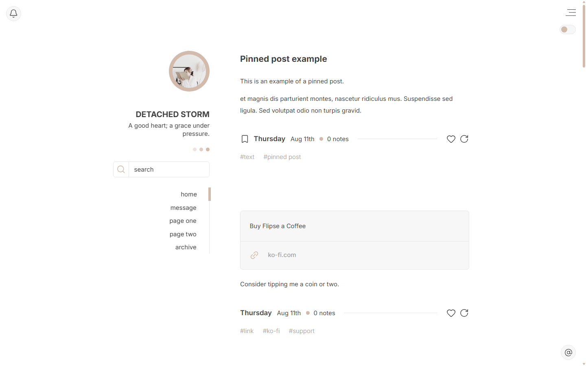

# Broek Tumblr Theme

A responsive Tumblr theme with a single post column and a sticky sidebar that can sit on the left or right. Optional dark mode, search bar, update tab and Tumblr controls. Full support of NPF posts.

## Preview

Two examples with different options turned on:

- [Preview 1](https://flipseprvs.tumblr.com/broek1)
- [Preview 2](https://flipseprvs.tumblr.com/broek2)

## Install and customize

See the [theme guide](GUIDE.md) for installation and all options.

The `.js` files in this repo are uploaded to Tumblr's Theme assets. The theme loads them from Tumblr's CDN, so all you need is `broek.html`.

## Changelog

See [CHANGELOG.md](CHANGELOG.md).

## License & terms

Broek Tumblr Theme, distributed by **Mournstera**, is licensed under the [Creative Commons Attribution-NonCommercial-NoDerivatives 4.0 International](https://creativecommons.org/licenses/by-nc-nd/4.0/) licence. Please carefully read my [terms of use](https://mournstera.tumblr.com/themes) before installing.

## Credits

© Flipse / [@mournstera](https://mournstera.tumblr.com) · [Credit page](https://mournstera.tumblr.com/credit)
